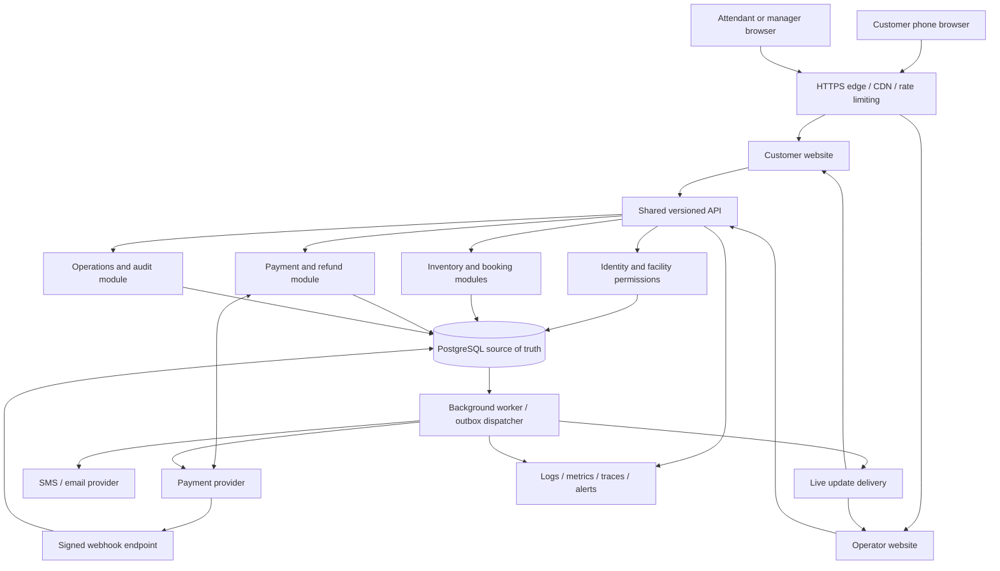
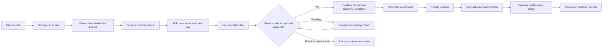
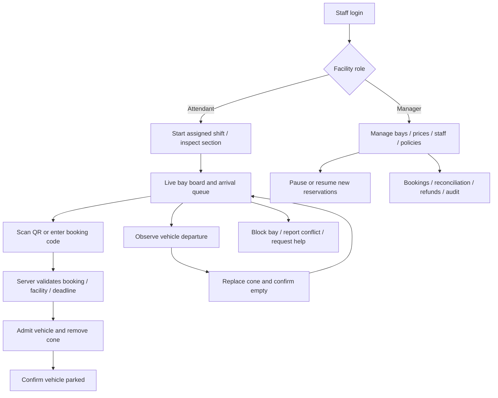
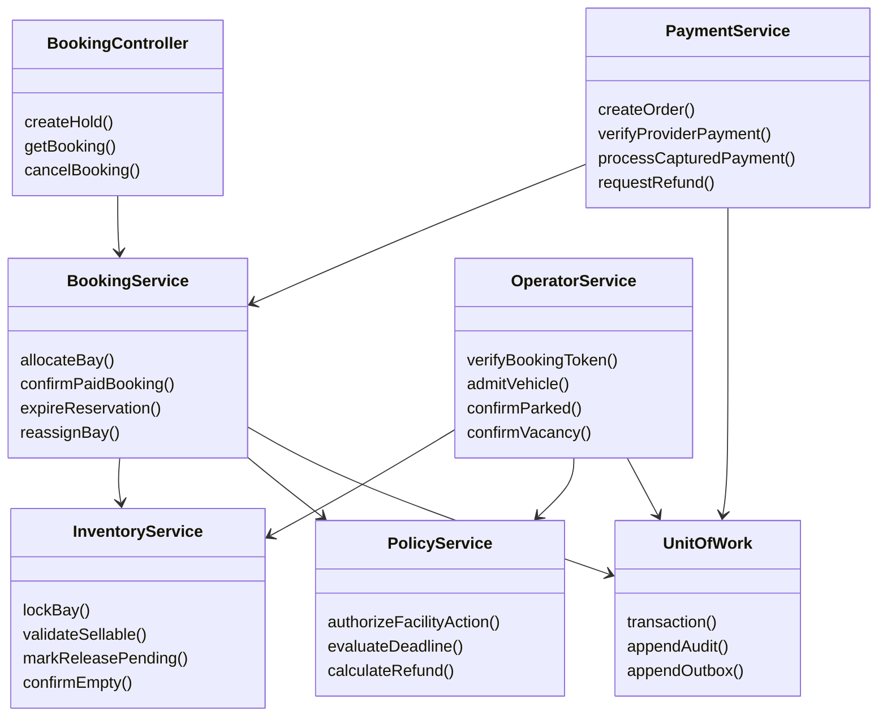
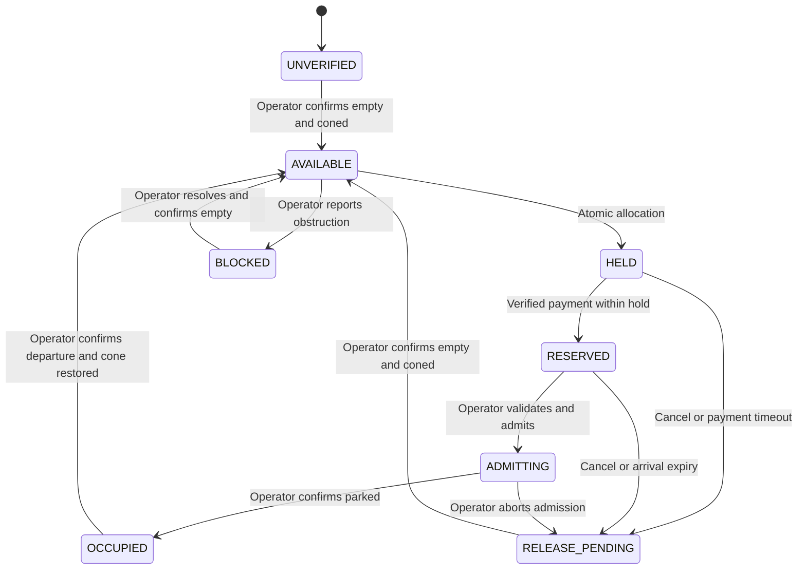
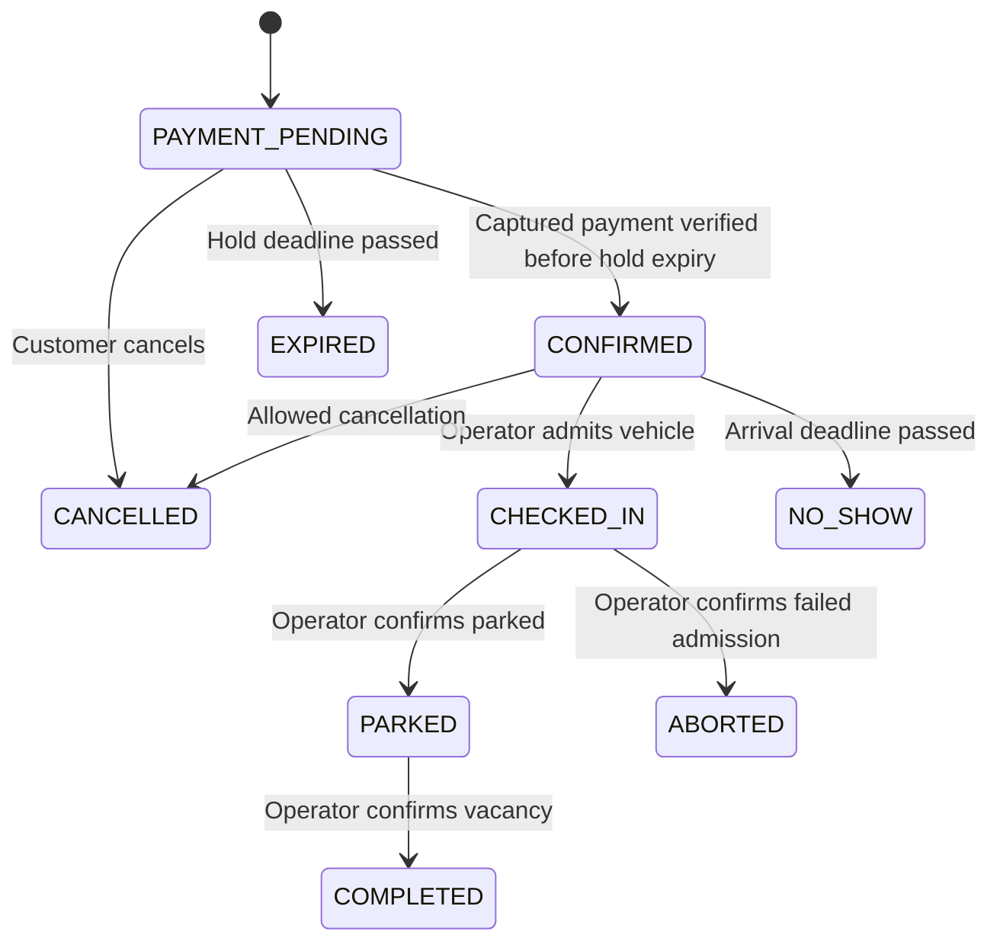
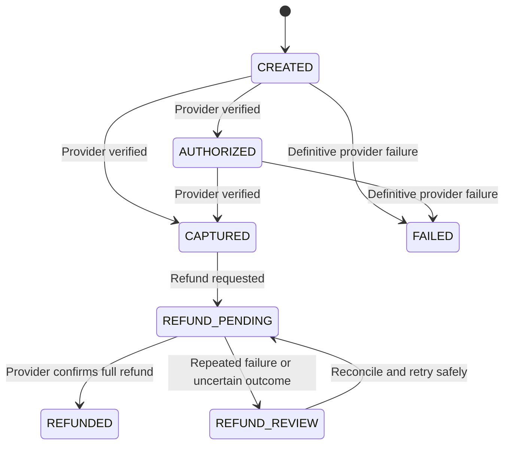
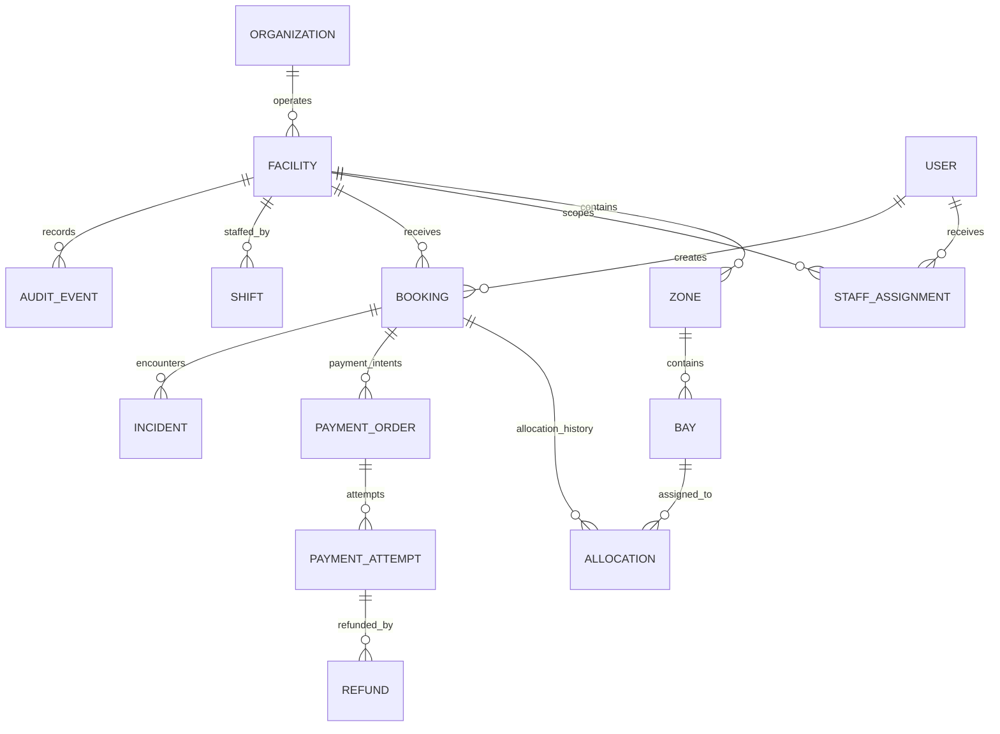
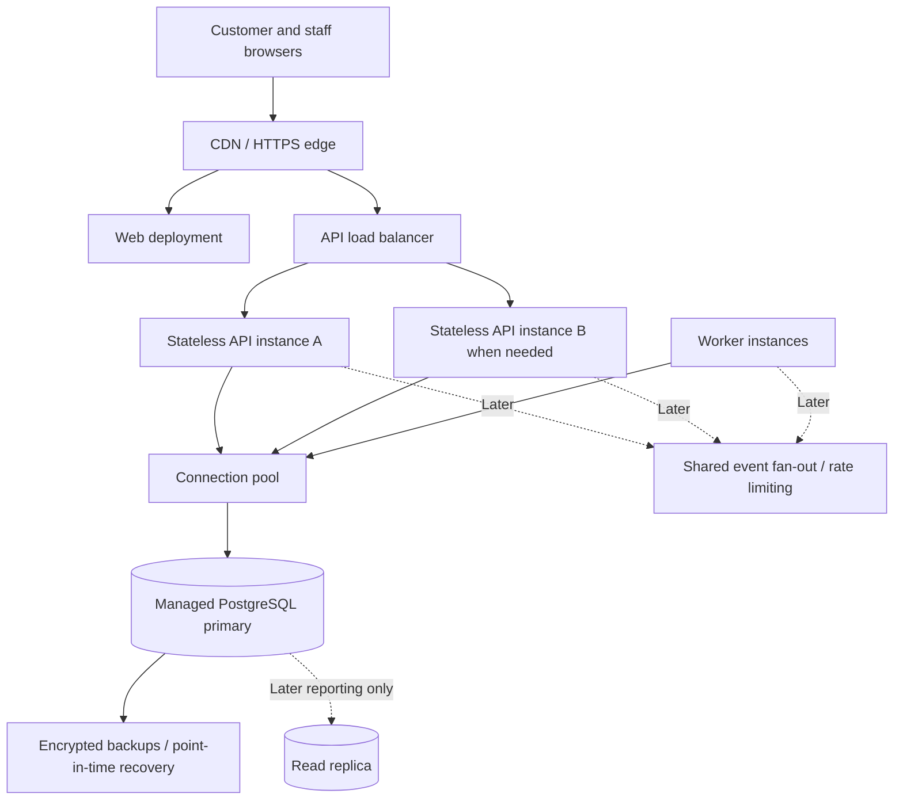

# Mall parking reservation platform — HLD and LLD

Design version: 1.0 · 17 September 2026 · Proposed architecture, not implemented software.

## 1. Scope and assumptions

Two responsive websites: a customer booking website and a staff website with attendant and manager roles. One shared backend and database. The mall provides a dedicated, coned parking section and an attendant. The ordinary mall parking ticket and parking charge remain separate from the reservation fee.

MVP supports immediate arrival reservations, cars and bikes in explicitly compatible bays, online reservation payment, operator check-in, and operator-confirmed vacancy. It does not support future time-slot bookings: departure time is unknown, so selling the same bay for a future interval would require a different allocation model.

Customers can select a bay, or request any compatible bay. Both paths allocate a specific bay in the database before payment. Reassignment requires an atomic operator action and is recorded. Prices, payment hold duration, arrival grace period, cancellation rules, and opening hours are configurable per facility. Example durations below are pilot hypotheses, not requirements.

GPS is optional discovery assistance. No strict 50 m gate and no automatic 200 m release. Website background execution is not relied upon. Only an authorized attendant physically confirming an empty bay with its cone restored can return it to sale.

## 2. Non-negotiable rules

1. At most one active allocation exists per bay, regardless of API instance or user count.
2. An occupied, blocked, unchecked, or stale bay cannot be sold.
3. The server controls prices, time, authorization, payment verification, and transitions.
4. A client payment success screen is not proof of captured payment.
5. Reservation expiry never automatically makes a bay available. It enters RELEASE_PENDING until the operator confirms empty and restores the cone.
6. Customer departure requests notify staff; they never release inventory.
7. Every meaningful mutation is idempotent and audited. Events can be delivered more than once without duplicating business effects.
8. A manager can pause sales but cannot bypass the physical vacancy confirmation rule.

## 3. HLD — overall architecture



Recommended initial implementation: TypeScript, Next.js for both web frontends, a NestJS modular backend, PostgreSQL, and a separate worker process from the same backend codebase. Use a supported stable version of each at implementation time. PostgreSQL-backed jobs and an outbox are sufficient for the pilot. Redis is optional later for shared rate limits and live-event fan-out; never use it as the authority for bay ownership.

This is a modular monolith: clear internal boundaries without separate microservices, databases, or distributed transactions for each module. Deployment units are web, API, and worker. Native apps can later reuse the versioned API.

## 4. HLD — customer website



Pages: mall list, facility details, bay map/list, checkout, booking detail, booking history, refund status, help. Show reservation fee separately from the regular parking charge before payment. Use labelled statuses as well as colours. A list view must work without a map or location permission.

Frontend modules: session, facilities, availability, checkout, bookings, receipts, notifications. Fetch authoritative booking status after payment, browser focus, and network reconnection. Countdown displays use server expiry timestamps; local countdown reaching zero does not mutate inventory. Refresh stale availability before submitting a hold. A receipt or QR can be cached for viewing, but cached content cannot prove current booking validity.

## 5. HLD — operator and manager website



Attendant screens: large bay cards, expected arrivals, booking scanner, departure confirmations, incidents, shift handover. Each action shows the bay number and vehicle context to reduce wrong-bay taps. Require explicit confirmation for vacancy; do not make it an easy accidental toggle. Only acknowledge success after the server commits.

Manager screens: facility setup, bay layout, staff assignments, fee and policy versions, operational reports, refund review, incidents. Staff cannot see another facility's data by changing a URL. Manager permissions do not implicitly grant field-attendant actions; assign that role explicitly where needed.

## 6. LLD — component boundaries



Controllers validate input and permissions. Services implement transitions. Repositories contain SQL; UnitOfWork ensures related changes, audit entries, and outbox entries commit together. Provider adapters encapsulate payment/SMS APIs. Domain services never call external providers while holding database locks.

## 7. LLD — separate state machines

### Bay state



Operational blocking is also stored separately from allocation status: a RESERVED or OCCUPIED bay can have an incident without deleting its allocation or falsifying occupancy. An incident disables new sales and prompts reassignment or resolution. Shift coverage is a facility/section eligibility condition, not a reason to erase existing bookings.

### Booking state



PAYMENT_PENDING and CONFIRMED reservations can expire; CHECKED_IN and PARKED bookings cannot be released by those timers. A stuck CHECKED_IN record produces an operator alert, never an automatic vacancy. Admission failure uses a service-failure refund policy and RELEASE_PENDING.

### Payment state



Payment attempts are separate records: a failed attempt must not overwrite another successful attempt. Authorized-only funds do not confirm a booking. A late captured payment on an expired booking triggers a refund; it never resurrects that reservation. MVP supports full refunds; partial refunds require additional amount accounting and policy.

## 8. LLD — booking and payment sequence

```mermaid
sequenceDiagram
    actor C as Customer
    participant W as Customer website
    participant A as API
    participant D as PostgreSQL
    participant P as Payment provider
    participant B as Worker
    C->>W: Select bay and reserve
    W->>A: POST /holds + idempotency key
    A->>D: Lock bay; validate; create hold and allocation
    D-->>A: Commit booking, audit, outbox
    A-->>W: Hold ID and expiry
    W->>A: POST /bookings/id/payment-order
    A->>D: Persist payment-order intent
    A->>P: Create order with supported retry safeguards
    P-->>A: Provider order ID
    A->>D: Persist provider order mapping
    A-->>W: Checkout details
    W->>P: Hosted checkout
    P-->>W: Checkout result
    W->>A: Request payment verification
    A->>P: Verify order, captured status, amount, currency
    P-->>A: Authoritative payment details
    P->>A: Signed webhook (may repeat or arrive earlier)
    A->>D: Store deduplicated verified event
    B->>D: Apply payment through same idempotent handler
    Note over A,D: Lock bay then booking; confirm only if eligible at DB time
    W->>A: GET booking status
    A->>D: Read authoritative state
    D-->>A: Booking and payment state
    A-->>W: Confirmed booking or processing status
    B->>D: Read committed outbox
    B-->>W: Publish refresh notification
```

Both foreground verification and webhook processing call the same payment transition service. Browsers never connect directly to PostgreSQL. Webhooks are acknowledged only after durable recording. If provider verification is unavailable, show processing and keep reconciliation running; do not invent payment success.

Example starting policy: a three-minute payment hold and a ten-minute arrival window after confirmation. Tune these against actual payment and entrance-queue timing. Store deadlines as UTC timestamps and use database time for eligibility. Deadline extensions require authorized, audited actions before expiry.

## 9. LLD — arrival and departure sequence

```mermaid
sequenceDiagram
    actor C as Customer
    actor O as Operator
    participant S as Staff website
    participant A as API
    participant D as Database
    C->>O: Show booking QR
    O->>S: Scan QR and check vehicle
    S->>A: Verify booking token
    A->>D: Read authorized live booking
    A-->>S: Bay, vehicle, paid status, arrival eligibility
    O->>S: Admit customer
    S->>A: POST check-in + idempotency key
    A->>D: Lock and commit CONFIRMED to CHECKED_IN
    A-->>S: Admission accepted
    O->>C: Remove cone and direct to bay
    O->>S: Confirm parked
    S->>A: POST parked
    A->>D: Commit OCCUPIED and PARKED
    Note over C,O: Vehicle stays under ordinary mall parking rules
    C->>O: Vehicle leaves
    O->>O: Observe empty bay and replace cone
    O->>S: Confirm vacancy
    S->>A: POST confirm-vacancy + expected version
    A->>D: Complete booking; release allocation; mark available; audit
    A-->>S: Success and new bay version
```

QR contains a cryptographically random opaque token with sufficient entropy; store its hash. It contains no phone number or payment secrets. A scan is read-only; the explicit check-in command consumes admission eligibility once. Replays cannot admit a second vehicle. Manual code lookup is rate-limited and still requires vehicle verification and staff authorization.

## 10. LLD — data model



| Table | Important fields and constraints |
|---|---|
| organizations | id, name, status |
| facilities | id, organization_id, name, address, entrance coordinates, timezone, sales_enabled, policy_version |
| zones | id, facility_id, label, floor, sales_enabled, coverage_valid_until |
| bays | id, facility_id, zone_id, label, vehicle_type, state, operational_blocked, version, last_verified_empty_at; unique facility + label |
| users | id, verified_contact, status; contacts encrypted where appropriate |
| staff_assignments | user_id, facility_id, role, enabled; unique user + facility + role |
| shifts | id, facility_id, zone_id, operator_id, started_at, ended_at, last_heartbeat_at |
| bookings | id, facility_id, customer_id, vehicle_type, vehicle_reference, status, fee_paise, currency, policy_snapshot, hold_expires_at, arrival_deadline, checked_in_at, completed_at, qr_token_hash, version |
| allocations | id, facility_id, booking_id, bay_id, created_at, released_at; partial unique active bay and active booking |
| payment_orders | id, booking_id, provider, provider_order_id, merchant_reference, expected_amount_paise, currency, status; unique provider order when present |
| payment_attempts | id, payment_order_id, provider_payment_id, status, captured_amount_paise; unique provider payment |
| refunds | id, payment_attempt_id, amount_paise, reason, status, provider_refund_id, request_key; unique request key |
| webhook_inbox | provider, event_id, payload/reference, received_at, processing_status; unique provider + event ID |
| idempotency_records | actor_id, route, key, request_hash, status, response, expires_at; unique actor + route + key |
| outbox_events | id, facility_id, aggregate_id, aggregate_version, type, payload, attempts, next_attempt_at, published_at |
| incidents | id, facility_id, bay_id, booking_id nullable, type, status, resolution, created_by |
| audit_events | id, facility_id, actor_id, action, entity_type, entity_id, before/after summary, request_id, created_at |

All cross-facility references must be protected with composite foreign keys or equivalent validated constraints. A booking cannot point to a bay belonging to another facility. Store money as integer paise, never floating point. Store timestamps in UTC; display using the facility timezone. Avoid storing card details; use hosted checkout.

Critical allocation constraints:

```sql
CREATE UNIQUE INDEX uq_active_bay_allocation
ON allocations (bay_id) WHERE released_at IS NULL;

CREATE UNIQUE INDEX uq_active_booking_allocation
ON allocations (booking_id) WHERE released_at IS NULL;
```

These guarantee at most one active allocation; services and consistency checks ensure bookings that require allocations have one. An expired booking can retain its allocation while RELEASE_PENDING until the operator clears the bay. Historical allocations support reassignment and dispute investigation.

Other indexes: bookings(customer_id, created_at DESC); bookings(facility_id, status, arrival_deadline); bays(facility_id, zone_id, vehicle_type, state); shifts(zone_id, ended_at); pending jobs by next_attempt_at; unpublished outbox events; unprocessed webhook events. Use partial expiry indexes for PAYMENT_PENDING and CONFIRMED only. Avoid indexing every column.

## 11. LLD — allocation, locking, and idempotency

Hold creation transaction:

```text
Authenticate customer; validate request and idempotency key.
BEGIN
  Claim idempotency record; same key with different payload => conflict.
  Read facility/zone eligibility under a lock compatible with the pause protocol.
  Lock selected compatible bay FOR UPDATE.
    For any-bay selection use FOR UPDATE SKIP LOCKED LIMIT 1.
  Recheck: sales enabled, coverage fresh, state AVAILABLE,
           no operational block, no active allocation.
  Create PAYMENT_PENDING booking using server price and policy snapshot.
  Create active allocation; change bay to HELD; increment version.
  Write audit + outbox + idempotent response in same transaction.
COMMIT
Return hold and deadline.
```

Use PostgreSQL READ COMMITTED with explicit row locking and database constraints. All writers obey the same lock order: facility/zone control rows where required, bays in sorted ID order, booking, payment/refund records. Eligibility reads use shared locks; pause/coverage changes use exclusive row updates, so a completed pause blocks subsequent allocations. Retry bounded deadlocks and serialization-style conflicts safely. Keep transactions short.

For payment confirmation, cancellation, expiry, check-in, and vacancy, first locate allocation IDs, acquire locks in the standard order, then re-read and validate. If an allocation changed, restart safely. Reassignment locks both bays in sorted order, releases the old allocation and creates the new one atomically; the old bay stays RELEASE_PENDING until inspected.

Expiry worker rechecks state and database time inside the lock. A race with check-in resolves through the lock: one valid transition wins. Availability responses are advisory; hold creation is authoritative. Do not use a Redis distributed lock as the primary double-booking protection.

Every mutation accepts an Idempotency-Key. Save request hash and response with the business transaction. Repeated identical requests return the original outcome; payload mismatch returns 409. Financial commands additionally have durable unique business keys beyond the general idempotency retention period.

## 12. LLD — API contracts

Prefix: /api/v1. JSON responses include request_id; paginated lists use cursors. Private reads enforce ownership or facility role.

| Method and route | Caller | Purpose |
|---|---|---|
| GET /facilities | Public | Discover participating malls |
| GET /facilities/{id}/availability?vehicleType=CAR | Public | Bay availability with version, observed_at, stale flag |
| POST /holds | Customer | Atomically hold a selected or any compatible bay |
| GET /bookings/{id} | Owner / scoped staff | Current booking and payment state |
| POST /bookings/{id}/payment-order | Owner | Create/reuse eligible payment order |
| POST /bookings/{id}/verify-payment | Owner | Server verifies checkout result with provider |
| POST /bookings/{id}/cancel | Owner / authorized staff | Apply cancellation policy |
| POST /bookings/{id}/departure-request | Owner | Notify operator only |
| GET /me/bookings | Customer | Paginated history |
| POST /operator/verify-booking | Attendant | Validate QR token in request body |
| POST /operator/bookings/{id}/check-in | Attendant | Consume admission eligibility |
| POST /operator/bookings/{id}/parked | Attendant | Confirm physical occupation |
| POST /operator/bookings/{id}/abort-admission | Attendant | Record failed admission; initiate policy resolution |
| POST /operator/bays/{id}/confirm-vacancy | Attendant | Confirm empty + cone restored; atomically release |
| POST /operator/bookings/{id}/reassign | Authorized staff | Atomic reassignment to compatible available bay |
| POST /operator/bays/{id}/incidents | Attendant | Block/report physical conflict |
| POST /operator/shifts | Attendant | Start shift and inspection workflow |
| POST /operator/shifts/{id}/heartbeat | Attendant | Update coverage signal |
| POST /operator/shifts/{id}/end | Attendant | End or hand over coverage |
| PATCH /manager/facilities/{id}/sales | Manager | Pause/resume new sales with reason |
| POST /manager/bookings/{id}/refunds | Authorized manager | Request eligible audited refund |
| POST /webhooks/payments/{provider} | Signed provider | Durable deduplicated payment event intake |
| GET /operator/events | Scoped staff | SSE updates or polling fallback |

Example hold request:

```json
{
  "facility_id": "facility_uuid",
  "bay_id": "bay_uuid",
  "vehicle_type": "CAR",
  "vehicle_reference": "customer_vehicle_reference"
}
```

Omit bay_id for server assignment. The client does not set the price. A vacancy request includes expected_version, empty_confirmed: true, and cone_restored: true. The server records who confirmed; these booleans do not replace staff authorization or physical procedure.

Errors: 401 unauthenticated, 403 unauthorized, 404 unavailable/private object, 409 stale version or bay conflict, 422 invalid transition or input, 429 rate limit, 503 unavailable dependency. Payment processing is a normal pending state, not automatically a failure. Return structured error codes such as BAY_UNAVAILABLE, BOOKING_EXPIRED, COVERAGE_UNAVAILABLE, and PAYMENT_PROCESSING.

## 13. Payment reliability and refunds

Use a provider adapter, initially an India-compatible hosted checkout provider such as Razorpay after commercial onboarding. Verify signatures over the raw webhook body. Deduplicate provider events and validate merchant account, order mapping, amount, currency, and captured state. Treat out-of-order notifications as facts to reconcile rather than instructions to blindly overwrite status.

External order/refund creation is a persisted intent followed by an external call, then a recorded result. Use provider idempotency where supported. If the request times out after possible provider success, reconcile using its reference/API before retrying; do not assume every provider endpoint supports idempotency. Ambiguous financial outcomes enter review instead of issuing duplicate refunds.

Automatically request a full refund for verified captured funds that cannot produce a valid reservation. Customer cancellation/no-show refunds follow the policy snapshot accepted during checkout. If two captured payments exist for one booking, accept at most one towards the booking and refund the duplicate. Total refunds cannot exceed the captured amount; enforce this under payment row locking. A scheduled reconciliation job compares unresolved records with provider data and alerts on aged discrepancies.

## 14. Live updates and connectivity

Pilot: foreground polling every few seconds with jitter and ETags is acceptable. SSE is an upgrade for fast operator board changes without continuous polling. Browser commands remain ordinary HTTPS requests. An SSE notification carries entity ID and version; the client fetches authoritative state. Reconnect with backoff and refresh a complete snapshot after gaps. Never assume in-memory events are durable.

At multiple API instances, route committed outbox notifications through shared fan-out or a dedicated event gateway; an event arriving at one API instance must reach clients connected elsewhere. Duplicates are harmless through entity versions. Never expose customer or staff events through an unscoped public stream.

Operator coverage: heartbeat while an active shift is attended, plus explicit shift handover and physical checks. A heartbeat indicates connectivity, not proof that a human is watching. When coverage expires, stop new holds and new confirmations, retain existing confirmed reservations, and alert staff. A paid but unconfirmable hold is refunded. Resume only after operator reconciliation. The timeout must be configurable and tested for backgrounded browsers.

Offline staff view is read-only with a prominent stale indicator. Do not queue check-ins or vacancy mutations for silent later submission. During an outage, pause sales server-side when coverage becomes stale. If staff manually honour previously verified bookings, log them through a documented outage procedure and reconcile every affected bay before sales resume. Browser UI cannot guarantee safe automatic offline admission.

## 15. Security and privacy

Customer identity via managed login or verified phone OTP; protect OTP sends with throttling and abuse controls. Staff use individual accounts, scoped roles, short-lived sessions, and stronger authentication for manager financial actions. Use Secure, HttpOnly cookies, CSRF protection for cookie-authenticated mutations, HTTPS, restrictive CORS, and input validation. Derive facility scope from authenticated assignments, never just request parameters.

Separate public inventory payloads from private booking payloads. Redact contact details, QR tokens, credentials, and payment payloads in logs. Encrypt sensitive data and backups; store secrets in managed secret storage. Define retention/deletion rules before launch, keeping required financial records separately from unnecessary location history. Do not collect continuous location for this design. Append-only application audit records cover price changes, refunds, reassignment, vacancy, and permission changes.

## 16. Deployment and scaling



Stage 1: one region near users, managed database, one API deployment and one worker, CDN-hosted assets, database-backed jobs, polling. Use separate development/staging/production environments and provider sandbox for staging.

Stage 2: multiple API and worker instances, shared rate limiting/fan-out, connection pooling, managed high availability, load tests based on observed peaks. Workers claim jobs safely and retry with backoff. Scale according to request latency, database lock wait, connection count, and queue age, not mall count alone.

Stage 3: read replicas for analytics, archival/partitioning of large audit/event tables, dedicated notification/reporting services if measurements justify extraction. Keep booking and inventory transactions together. Multi-region writes and database sharding are unnecessary until evidence demands them.

Availability and allocation decisions use the primary database; replica lag must not decide whether a bay can be sold. Cache static facility metadata and short-lived public summaries only. Serve no stale cache as a booking guarantee. Deploy backward-compatible schema changes and rehearse restoration. No architecture is unlimited; benchmark on the actual hosting plan before claiming capacity.

## 17. Operational metrics and initial targets

Proposed targets to validate, not measured promises: ordinary API p95 below 500 ms excluding providers; foreground bay updates within 5 seconds; no overselling; alerts for aged captured-but-unconfirmed payments and stalled refunds. Agree uptime, recovery-time, and recovery-point objectives with the operator and select hosting accordingly.

Track reservation fulfilment rate, operator correction rate, time from departure to release, check-in duration, no-show rate, unavailable booked bays, payment reconciliation age, refund completion time, stale coverage duration, database contention, and revenue per staffed hour. Correlate logs and traces by request, booking, facility, and payment IDs without leaking personal data.

## 18. Required verification before a pilot

| Test | Expected result |
|---|---|
| Many concurrent requests for one bay | Exactly one active allocation |
| Duplicate hold request after lost response | Same booking returned |
| Payment webhook repeats or arrives out of order | One accepted payment effect; no duplicate booking/refund |
| Payment captured after hold expires | No resurrection; refund workflow |
| Check-in races with arrival expiry | One valid transition, no oversell |
| Customer taps departure request | Bay remains occupied |
| Operator submits an old bay version | Conflict; refresh required |
| Operator confirms vacancy twice | Idempotent outcome |
| Reassignment races with another booking | Atomic success or conflict, never double allocation |
| Worker crashes after a commit | Outbox/job retries recover safely |
| Coverage or network disappears | Sales stop; existing inventory preserved |
| Staff tries another facility's booking | Access denied |
| Captured payment amount or currency differs | No confirmation; investigation/refund |
| Database restore rehearsal | Bookings and financial reconciliation recover within agreed objectives |

Use real database concurrency tests, provider sandbox integration tests, browser end-to-end tests for both roles, and a physical peak-hour rehearsal with cones. A simulated happy path alone is insufficient.

## 19. Suggested repository layout and delivery order

```text
apps/
  customer-web/
  operator-web/
  api/
    modules/auth/
    modules/facilities/
    modules/inventory/
    modules/bookings/
    modules/payments/
    modules/operations/
    modules/audit/
  worker/
packages/
  contracts/
  ui/
  database/
docs/
```

Delivery order: (1) facility/bay setup, roles, and operator inventory; (2) transactional booking and expiry; (3) provider checkout, verification, refunds, reconciliation; (4) QR admission, parking and vacancy; (5) live updates, coverage and incident handling; (6) reporting, operational rehearsal and pilot. Keep payment security, audit, and concurrency protection in the initial release.

## 20. Implementation references

- [PostgreSQL explicit locking](https://www.postgresql.org/docs/17/explicit-locking.html): row locks underlying transactional allocation. The database constraints and transaction protocol above are this design's application-level recommendations.
- [Razorpay webhook validation and testing](https://razorpay.com/docs/webhooks/validate-test/): signature validation, duplicate events, and event ordering considerations.
- [Razorpay web checkout integration](https://razorpay.com/docs/payments/payment-gateway/web-integration/standard/integration-steps/): server verification and checkout integration. Confirm endpoint-specific retry and refund semantics during implementation.
- [MDN server-sent events](https://developer.mozilla.org/en-US/docs/Web/API/Server-sent_events/Using_server-sent_events): browser event streaming option. Polling remains adequate for the initial pilot.

Open business decisions before implementation: exact arrival/hold deadlines; customer cancellation and no-show policy; who receives booking revenue and issues refunds; staff coverage arrangement; whether customers choose exact bays or accept automatic assignment. These change configuration and commercial operations, not the fundamental two-website architecture.
